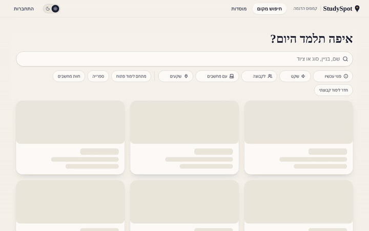
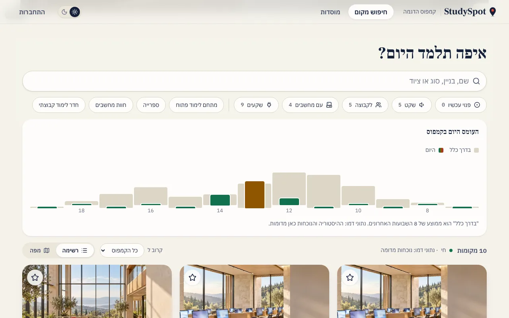
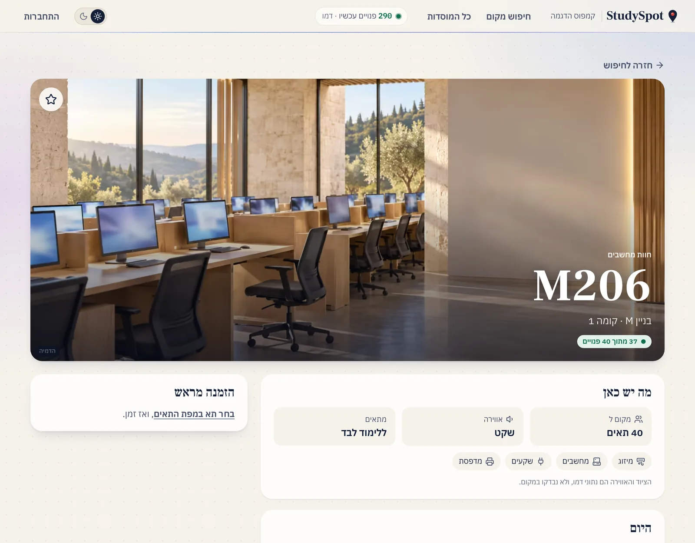
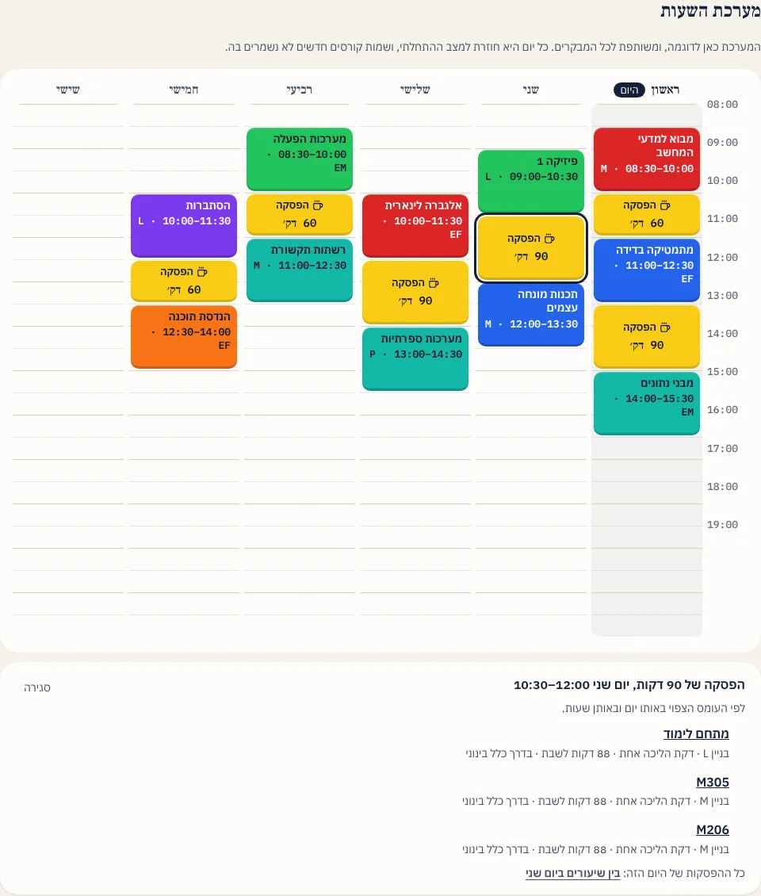
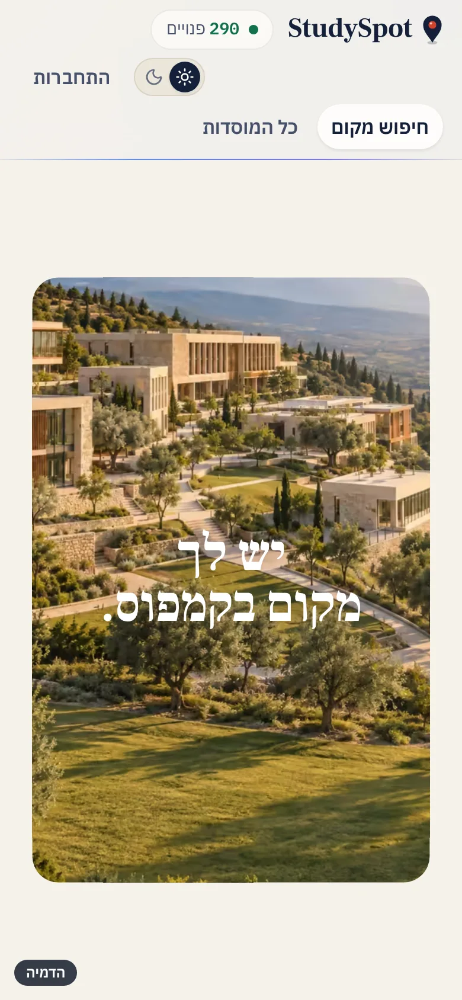
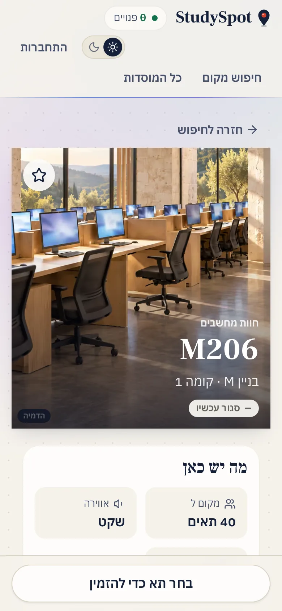
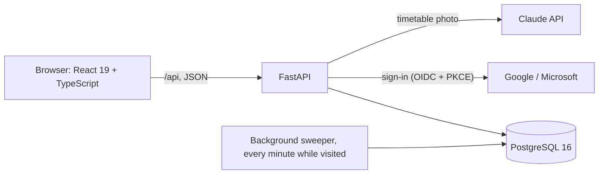

# StudySpot

Find a place to study on campus: what is free right now, what is usually free later, and where to sit between your classes.

> **Live demo:** https://studyspot-yetb.onrender.com. It opens on a demo campus; sign in as the demo student or demo admin, or with Google.
> The free server sleeps after 15 idle minutes, so the first visit can take about a minute.
>
> A portfolio project, built in October 2026 by a second-year software engineering student at Braude College.



## The problem

Between two classes a student has, say, 50 minutes. Where to go? The library may be full, a computer lab two minutes away may have six free seats, and a group room may be free until 14:00. Today that means walking around to look.

The tools that exist each solve a part of it:

| Kind of tool | Example | What it does well | Why it is not enough here |
|---|---|---|---|
| Commercial library booking | Springshare LibCal | Mature room and seat booking, check-in, SMS | Paid, built around the library; no live picture of the whole campus on a map |
| Occupancy sensors | Waitz / Occuspace | Counts people with no effort from students | Hardware on every floor; says how busy, not which room or seat is free; no booking |
| What colleges use today | Braude: Microsoft Bookings for group rooms; Tel Aviv University: the libraries' app | Booking a room ahead | Booking only: no live occupancy, no campus map, no release of rooms nobody came to |
| Student projects on GitHub | many study-room booking apps | Book a slot, a QR "ticket" | Mostly booking only, often no shared server, double bookings checked in app code |

*Based on the products' public pages, checked in October 2026; details and sources in [docs/COMPETITIVE_ANALYSIS.md](docs/COMPETITIVE_ANALYSIS.md) (Hebrew). We did not test each product from the inside.*

## What StudySpot does differently

- **Between classes.** The student enters their week once (or imports it: the college's Excel export, or a photo read by Claude). For every break, on any day, the site suggests up to three places: open the whole break, near the next class, and not full now (or not usually full then), with the reason shown: "3 minutes' walk from building M, 40 minutes to sit, usually quiet". No product we found joins a student's timetable with occupancy.
- **Load, live and usual.** One chart per place and for the whole campus: how many people are there now, next to the average for that weekday and hour over the last eight weeks. A plain average per quarter hour, not machine learning: easy to explain and to test.
- **Live, booking and release in one place,** for four kinds of space: group rooms (booked whole), open areas and the library (scan in, seats counted), and computer labs (one QR code at the door, a seat map of every station). A booking nobody checks in to is released after 15 minutes.
- **No hardware.** QR signs printed from the admin page; the cost is relying on students to scan.
- **Any institution, one site.** An institution gets its own address and sets itself up: who signs in, buildings on the map, places, signs. No code and no copy of the project.
- **The database enforces the rules.** Two people booking the same room in the same second: a PostgreSQL exclusion constraint refuses the second, and a concurrency test proves it.

## Screenshots

| Finder: search, filters and today's campus load | A computer lab: details, today's load and seat map |
|---|---|
|  |  |

| The week, with a break's suggestions open | Phone, dark mode |
|---|---|
|  |   |

*Photos on the site are AI-generated illustrations, marked "הדמיה" (simulation); they are not photos of a real campus. Data on the demo campus is simulated.*

## Architecture



One container serves the web app and the API from the same address. The sweeper releases no-shows, ends expired check-ins and records occupancy history; it runs only while the site has visitors, so the database can sleep.

## Known limitations

- Occupancy is only as good as the scanning: auto check-out, "are you still here?" and no-show release reduce the error, they do not remove it.
- A photo of the QR sign could be scanned from home; one active check-in per person limits it.
- Walking times are a straight-line estimate, not a route.
- The demo campus's history and live crowd are simulated, and marked so on screen.
- Email notifications and password sign-in are planned, not built.

## Roadmap

Planned, not built yet (see [docs/PLAN.md](docs/PLAN.md), Hebrew):

- **Notifications:** email, and an optional Telegram bot, before a booking starts and before a no-show release. Waiting on a domain and a transactional email service (Brevo).
- **Password sign-in,** next to Google, Microsoft and the one-time email code.
- **Live updates** without the 30-second refresh.
- **Nightly database backups** beyond Neon's 6-hour restore window.

## Documentation

- [Project plan](docs/PLAN.md) (Hebrew)
- [Competitive analysis](docs/COMPETITIVE_ANALYSIS.md) (Hebrew)
- [Interview report](docs/INTERVIEW_REPORT.md) (Hebrew, updated every stage: decisions, challenges, competitors, interview Q&A)
- [Campus data](docs/CAMPUS_DATA.md) (Hebrew, filled in by hand)
- [Deploying the live demo](docs/DEPLOY.md) (Hebrew)
- [Launching at Braude for real](docs/BRAUDE_LAUNCH.md) (Hebrew)

## Running locally

```bash
cp .env.example .env              # then replace every change-me with one real password
docker compose up -d              # PostgreSQL 16
cd backend
python -m venv .venv && source .venv/bin/activate   # Windows: .venv\Scripts\activate
pip install --require-hashes -r requirements-dev.lock   # the exact locked versions
pip install --no-deps -e .
alembic upgrade head              # create the tables
python -m app.seed                # load Braude, and the demo campus the live site shows
python -m app.codes braude        # print the signed check-in code of every place
python -m app.sweeper             # one cleanup round (the server also runs it every 60 s)
python -m app.admin grant-role --email you@example.edu institution_admin
pytest                            # uses a separate studyspot_test database
uvicorn app.main:app --reload     # http://localhost:8000/health, docs at /docs
```

The web app, in a second terminal ([frontend/README.md](frontend/README.md)):

```bash
cd frontend
cp .env.example .env.local
npm install
npm run dev                       # http://localhost:5173
```

To sign in without a Microsoft account, set `DEMO_LOGIN_ENABLED=true` in
`.env`: the sign-in page then offers a demo student and a demo institution
admin, in the demo campus (`VITE_INSTITUTION=demo`). The server refuses demo
sign-in for an institution with real sign-in rules, so it can never hand out
a Braude admin.

## The whole site in one container

The image builds the web app and serves it next to the API (under `/api`),
from one address, so the sign-in cookie is first-party. It runs the
migrations and loads the campus data on start.

```bash
docker build -t studyspot .
docker run -p 8000:8000 --env-file .env -e SITE_URL=http://localhost:8000 studyspot
```

Every push runs [CI](.github/workflows/ci.yml): the server's tests on a real
PostgreSQL, the web app's lint, types, unit tests and build, the whole site
in a browser (Playwright, with an accessibility check), and the image.

## API (so far)

Paths as served by `uvicorn app.main:app`; in the container they are under `/api`.

| Method | Path | Who |
|---|---|---|
| GET | `/institutions/{slug}/buildings` | anyone |
| GET | `/institutions/{slug}/places?building=&kind=` | anyone |
| GET | `/places/{id}` | anyone |
| POST | `/check-ins` | signed in |
| GET | `/me/check-in` | signed in |
| POST | `/check-ins/{id}/checkout` | signed in, own check-in only |
| POST | `/bookings` | signed in |
| GET | `/me/bookings` | signed in |
| POST | `/bookings/{id}/cancel` | signed in, own booking only |
| POST | `/bookings/{id}/extend` | signed in, own booking only |
| GET | `/places/{id}/availability?date=` | anyone (busy times only, never who) |
| GET | `/institutions/{slug}` | anyone (name, time zone, booking rules) |
| GET | `/auth/providers` | anyone (which sign-in buttons to show) |
| GET | `/auth/{microsoft or google}/login` | anyone (redirects to the provider) |
| POST | `/auth/demo/login` | anyone, only when `DEMO_LOGIN_ENABLED=true` |
| POST | `/auth/refresh` | refresh cookie: returns a 15-minute access token |
| POST | `/auth/logout`, `/auth/logout-all` | signed in |
| GET | `/me` | signed in |
| GET | `/admin/institutions/{slug}/codes` | institution admin |
| POST | `/admin/places/{id}/revoke-code` | institution admin |
| POST | `/admin/buildings/{id}/location` | institution admin |

Sign-in setup (Microsoft app registration, `.env` values): [docs/AUTH_SETUP.md](docs/AUTH_SETUP.md) (Hebrew).

Interactive docs: http://localhost:8000/docs

## Status

- [x] Planning and research
- [x] Project skeleton (FastAPI health check, PostgreSQL in Docker)
- [x] Campus data
- [x] Data model (campus tables, migrations, Braude demo data)
- [x] Core API: places, live occupancy, check-in with signed codes
- [x] Bookings, renewal, no-show release and database-enforced double-booking prevention
- [x] Authentication: Microsoft and Google sign-in, roles, rate limiting
- [x] Web app, part 1: campus map, places list, place page with the lab seat map, demo sign-in
- [x] Web app, part 2: booking, QR check-in (`/scan#c=...`), my area, admin pages (printable QR signs, building placing)
- [x] CI, Docker, deployment (Render + Neon)
- [x] Many institutions on one site, with self-service setup, and a table import of buildings and places (Excel or CSV)
- [x] Occupancy prediction, live demo occupancy, places between classes, timetable import
- [ ] Notifications and password sign-in
