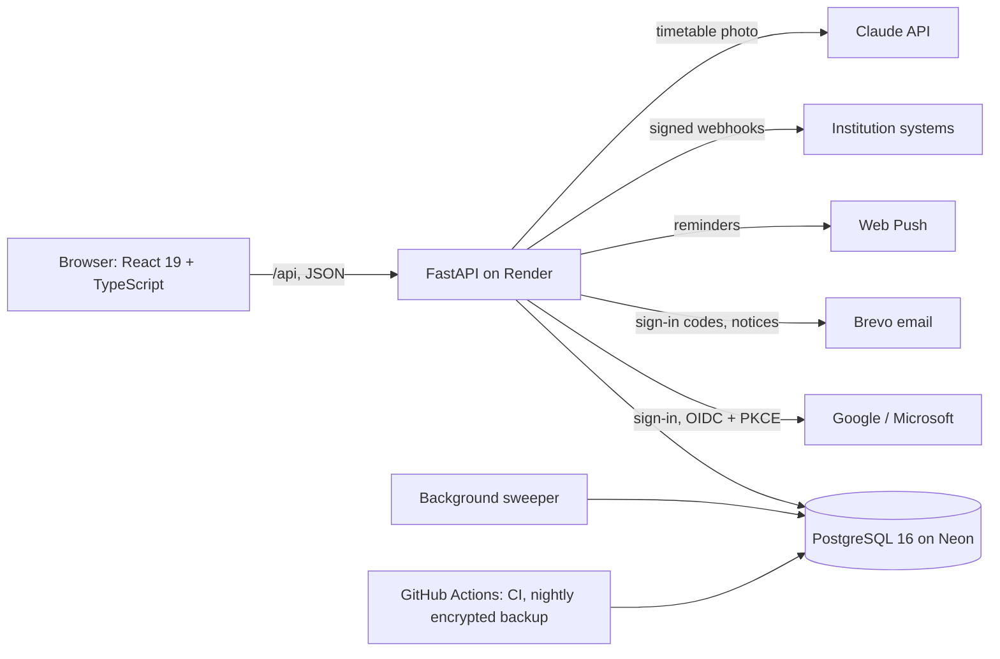

# StudySpot

Find a place to study on campus: what is free right now, what is usually free later, and where to sit between your classes.

> **Live:** https://getstudyspot.me. It opens on a demo campus: sign in as the demo student or the demo admin, or with Google.
> The free server sleeps after 15 idle minutes, so the first visit can take about a minute.
>
> A portfolio project, built in October 2026 by a second-year software engineering student at Braude College, working with Claude Code.


## In numbers

| | |
|---|---|
| Server tests (`pytest`, on a real PostgreSQL) | 1359 |
| Web app unit tests (`vitest`) | 581 |
| Browser tests (`Playwright`, with an `axe` accessibility check) | 42, plus 45 on desktop, iPad and phone |
| API routes, each with a row in an access table; refusals tested per role | 109 |
| Database tables | 29 |

*Counted on 26 October 2026.*

## The problem

Between two classes a student has, say, 50 minutes. Where to go? The library may be full, a computer lab two minutes away may have six free seats, and a group room may be free until 14:00. Today that means walking around to look.

The tools that exist each solve a part of it:

| Kind of tool | Example | What it does well | Why it is not enough here |
|---|---|---|---|
| Commercial library booking | Springshare LibCal | Mature room and seat booking, check-in, SMS | Paid, built around the library; no live picture of the whole campus on a map |
| Occupancy and booking, with sensors | Affluences | Live occupancy, forecasts and booking together; the closest product | Needs counting sensors or existing counting data; we saw no link to a student's timetable |
| Occupancy sensors only | Waitz / Occuspace | Counts people with no effort from students | Hardware on every floor; says how busy, not which room or seat is free; no booking |
| What colleges use today | Braude: Microsoft Bookings for group rooms; Tel Aviv University: the libraries' app | Booking a room ahead | Booking only: no live occupancy, no campus map, no release of rooms nobody came to |
| Student projects on GitHub | many study-room booking apps | Book a slot, a QR "ticket" | Mostly booking only, often no shared server, double bookings checked in app code |

*Based on the products' public pages and search results, checked in October 2026; details and sources in [docs/COMPETITIVE_ANALYSIS.md](docs/COMPETITIVE_ANALYSIS.md) (Hebrew). We did not test any product from the inside.*

## What StudySpot does differently

- **Between classes.** The student enters their week once, or imports it from the college's Excel export or from a photo read by Claude. For every break, on any day, the site suggests up to three places: open the whole break, near the next class, and not full, with the reason shown. No product we found joins a student's timetable with occupancy.
- **Load, live and usual.** One chart per place: how many people are there now, next to the average for that weekday and hour over the last eight weeks. A plain average per quarter hour, not machine learning: easy to explain and to test.
- **Live, booking and release in one place,** for four kinds of space: group rooms, open areas, the library, and computer labs with a seat map. A booking nobody checks in to is released after 15 minutes.
- **No hardware.** A printed QR sign at the door, or a screen whose code changes every minute, so a photo of it stops working.
- **Any institution, one site.** An institution gets its own address and sets itself up: who signs in, buildings on the map, places, signs. For its own systems: read-only API keys, signed webhooks, and a widget for its website.
- **The database enforces the rules.** Two people booking the same room in the same second: a PostgreSQL exclusion constraint refuses the second, and a concurrency test proves it.

## Screenshots

| Finder: search, filters and today's campus load | A computer lab: details, today's load and seat map |
|---|---|
|  |  |

| The week, with a break's suggestions open | Phone, dark mode |
|---|---|
|  |   |

*Photos on the site are AI-generated illustrations, marked "הדמיה" (simulation); they are not photos of a real campus. Data on the demo campus is simulated.*

## Architecture



One container serves the web app and the API from the same address, so the sign-in cookie is first-party. The sweeper releases no-shows, ends expired check-ins, sends reminders and records occupancy history. It runs while the site has visitors, or when a reminder is due, so the database can sleep.

## Security, in short

- Sign-in with Google or Microsoft (OIDC with PKCE), an email code, or a password (`argon2id`), with lockout after five tries.
- A 15-minute access token in memory and a refresh cookie (`HttpOnly`, `Secure`, `SameSite`), rotated on use.
- Every API route has a row in an access table that says who may call it. Tests then check the refusals: a guest, a student, an institution admin, another student's things, and another institution's things.
- A strict Content Security Policy, rate limits, a request body cap, and an SSRF guard for webhooks.
- `CodeQL`, `pip-audit`, `npm audit` and `gitleaks` on every push, and Dependabot every week.
- Details: [docs/testing/FINDINGS.md](docs/testing/FINDINGS.md) and the OWASP Top 10 table in the [interview report](docs/INTERVIEW_REPORT.md) (Hebrew).

## Known limitations

- Occupancy is only as good as the scanning: auto check-out, "are you still here?" and no-show release reduce the error, they do not remove it.
- A photo of a printed QR sign could be scanned from home. The door screen, with a code that changes every minute, closes this; one active check-in per person limits it otherwise.
- The demo campus's history and live crowd are simulated, and marked so on screen.
- The free hosting sleeps when idle, and the first visit is slow.

## Documentation

- [Interview report](docs/INTERVIEW_REPORT.md) (Hebrew): decisions, challenges, competitors, security, and interview questions.
- [Interview pack](docs/interview/) (Hebrew): requirements, pages, architecture, database, a booking end to end, and how it was tested.
- [Test plan](docs/testing/TEST_PLAN.md) and [findings](docs/testing/FINDINGS.md) (Hebrew).
- [API for institutions](docs/API.md), and on the live site the `/developers` page and `/api/v1/openapi.json`.
- [Competitive analysis](docs/COMPETITIVE_ANALYSIS.md) (Hebrew).
- [Deploying](docs/DEPLOY.md) and [services](docs/SERVICES.md) (Hebrew).

## Running locally

```bash
cp .env.example .env              # then replace every change-me with one real password
docker compose up -d              # PostgreSQL 16
cd backend
python -m venv .venv && source .venv/bin/activate   # Windows: .venv\Scripts\activate
pip install --require-hashes -r requirements-dev.lock   # the exact locked versions
pip install --no-deps -e .
alembic upgrade head              # create the tables
python -m app.seed                # load Braude, and the demo campus the live site shows
python -m app.codes braude        # print the signed check-in code of every place
python -m app.admin grant-role --email you@example.edu institution_admin
pytest                            # uses a separate studyspot_test database
uvicorn app.main:app --reload     # http://localhost:8000/health, docs at /docs
```

The web app, in a second terminal ([frontend/README.md](frontend/README.md)):

```bash
cd frontend
cp .env.example .env.local
npm install
npm run dev                       # http://localhost:5173
```

To sign in without a Google or Microsoft account, set `DEMO_LOGIN_ENABLED=true` in
`.env`: the sign-in page then offers a demo student and a demo institution
admin, in the demo campus. The server refuses demo sign-in for an institution
with real sign-in rules, so it can never hand out a real institution's admin.

## The whole site in one container

```bash
docker build -t studyspot .
docker run -p 8000:8000 --env-file .env -e SITE_URL=http://localhost:8000 studyspot
```

Every push runs [CI](.github/workflows/ci.yml): the server's tests on a real
PostgreSQL, the web app's lint, types, unit tests and build within a size cap,
the whole site in a browser on three devices, and the image.
