# StudySpot

Find a place to study on campus: what is free right now, what is usually free later, and where to sit between your classes.

**Live:** https://getstudyspot.me. It opens on a demo campus, and you can sign in as the demo student, as the demo admin, or with Google. The free server sleeps after 15 idle minutes, so the first visit can take about a minute.

**Reading this as a reviewer?** [Requirements](docs/design/requirements.md) · [Database](docs/design/database.md) · [Pages](docs/design/pages.md) · [How I built it](docs/design/process.md) · [Design decisions](docs/design/decisions.md)

I built StudySpot as my first complete web project, next to my second year of software engineering at Braude College. Most of the code was written with Claude Code, an AI coding tool. What is mine is the product, the specification, the decisions and the checks, and [How I built it](docs/design/process.md) shows each with its proof.

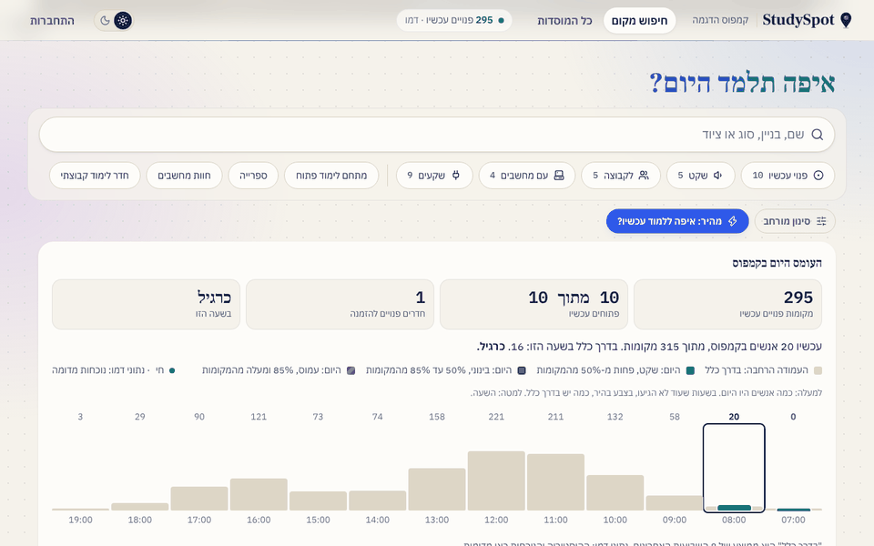

## The problem

Between two classes a student has, say, 50 minutes. Where to go? The library may be full, a computer lab two minutes away may have six free seats, and a group room may be free until 14:00. Today the only way to find out is to walk around and look.

The tools that exist each solve a part of it:

| Kind of tool | Example | What it does well | Why it is not enough here |
|---|---|---|---|
| Commercial library booking | Springshare LibCal | Mature room and seat booking, check-in, SMS | Paid, built around the library; no live picture of the whole campus on a map |
| Occupancy and booking, with sensors | Affluences | Live occupancy, forecasts and booking together; the closest product | Needs counting sensors or existing counting data; no link to a student's timetable that I could find |
| Occupancy sensors only | Waitz / Occuspace | Counts people with no effort from students | Hardware on every floor; says how busy, not which room or seat is free; no booking |
| What colleges use today | Braude: Microsoft Bookings for group rooms; Tel Aviv University: the libraries' app | Booking a room ahead | Booking only: no live occupancy, no campus map, no release of rooms nobody came to |
| Student projects on GitHub | many study-room booking apps | Book a slot, a QR "ticket" | Mostly booking only, often no shared server, double bookings checked in app code |

*Based on the public pages and listings of these products, when I wrote this. I did not try any of them from the inside.*

## What makes StudySpot different

- **Plans around your timetable.** Enter your week once, or upload the college's Excel export or a picture of your timetable, which AI reads. For every break the site suggests up to three places: open for the whole break, near your next class, and not full. Each suggestion comes with its reason. I found no other product that joins a timetable with occupancy.
- **Live and usual load, side by side.** One chart per place: who is there now, next to the typical crowd for that weekday and hour over the last eight weeks.
- **Booking, check-in and release in one place.** Group rooms, open areas, the library, and computer labs with a seat map. A booking nobody checks in to is released after 15 minutes.
- **When someone stays after their time.** A room whose time just ran out is shown as "maybe still taken" for a few minutes, a student can go on a break and keep the place, and one tap on "someone is in my place" returns free places nearby. The report holds no name, and each institution chooses how much of this it uses.
- **No hardware.** A printed QR sign at the door, or a screen whose code changes every minute.
- **One site, any institution.** Each institution gets its own address and sets itself up: who signs in, buildings on the map, places and signs. For its own systems it gets read-only API keys, signed webhooks and a widget for its website.
- **Rules that cannot be skipped.** Double booking is refused by the database itself, not only by the app.

## Demo video

A tour of the live demo campus, about 45 seconds. There are three versions on the [release page](https://github.com/itayG11/studyspot/releases/tag/demo-video-v1): English captions with an English voice, Hebrew captions with an English voice, and Hebrew captions with a Hebrew voice. The voice is computer generated.

## How I checked it

- Every stage ended with tests, and a separate review for code and for security.
- The live site was checked in real browsers and on a real phone, not only in tests.
- 1574 server tests (`pytest`, on a real PostgreSQL).
- 670 web app unit tests (`vitest`).
- 93 browser tests (`Playwright`, with `axe` and keyboard accessibility checks), and the device suite on desktop, iPad and phone (39 ran, 6 skipped on purpose, depending on the day).
- Real browsers on BrowserStack: Chrome, Edge, Firefox and WebKit on desktop, a real Pixel phone and an iPhone. See [the results](docs/browserstack/RESULTS.md).
- 31 database tables. Every API route has a row in an access table that says who may call it.

*Counted when I closed the last wave.*

## Screenshots

Each picture is shown in the light and the dark theme.

**Finder: search, filters and today's campus load**

| Light | Dark |
|---|---|
| 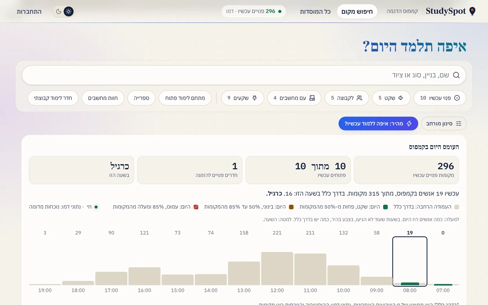 | 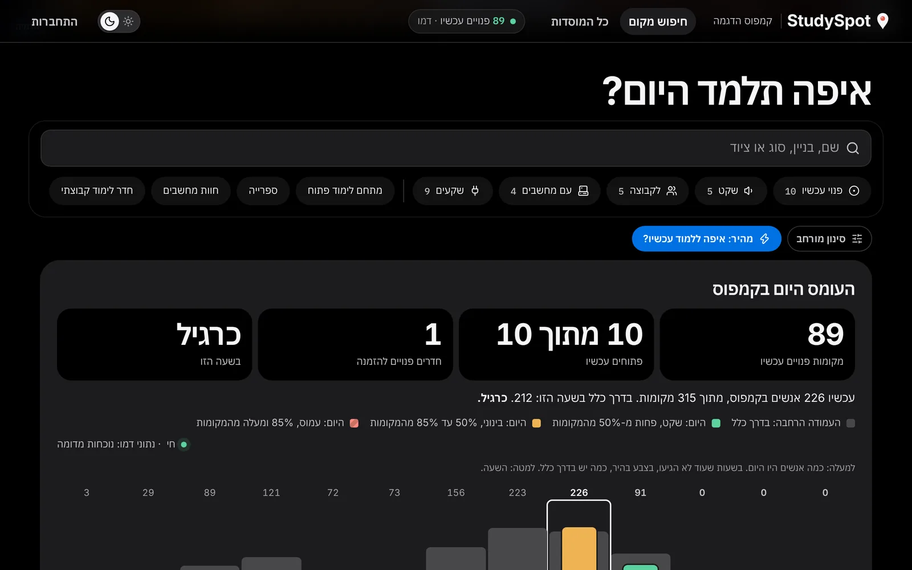 |

**A computer lab: details, today's load and seat map**

| Light | Dark |
|---|---|
| 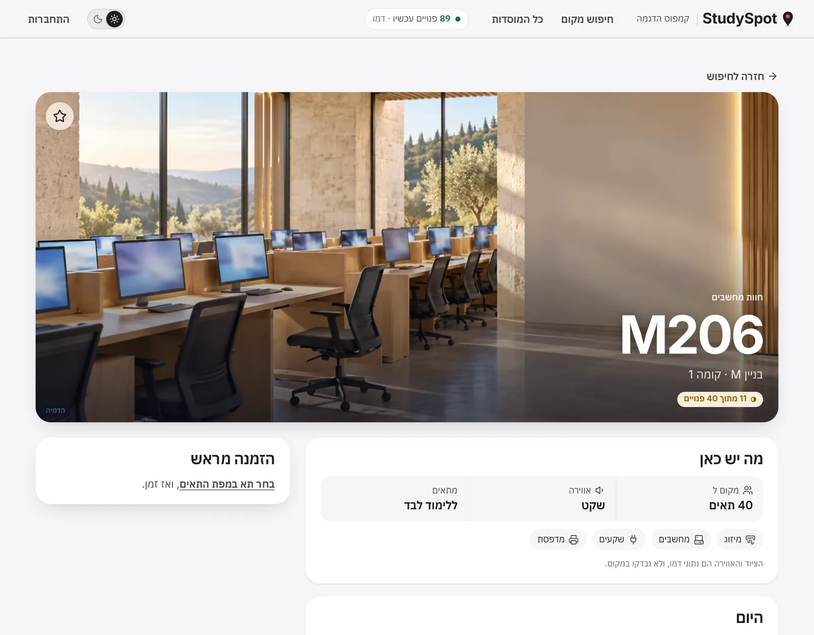 | 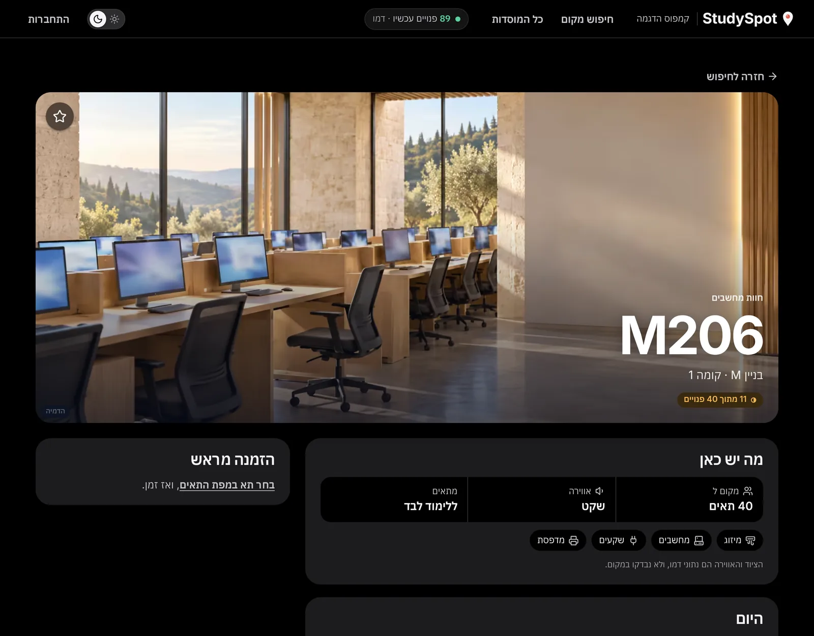 |

**The week, with each break between classes**

| Light | Dark |
|---|---|
| 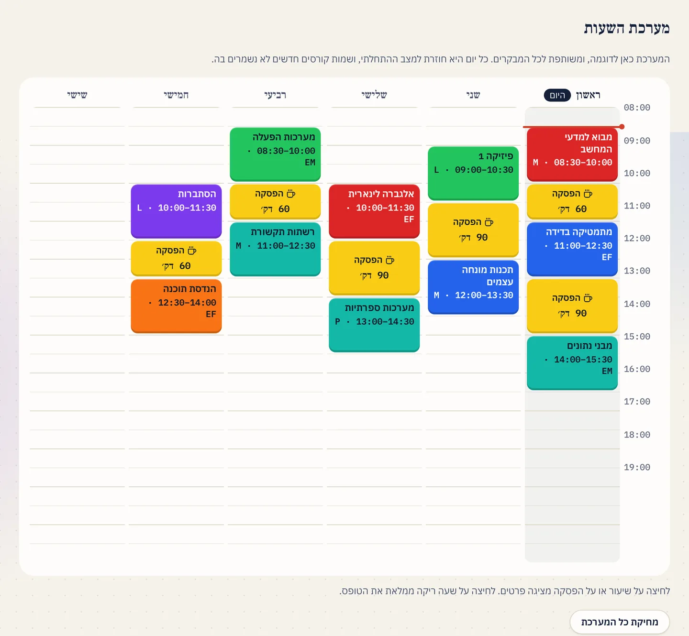 | 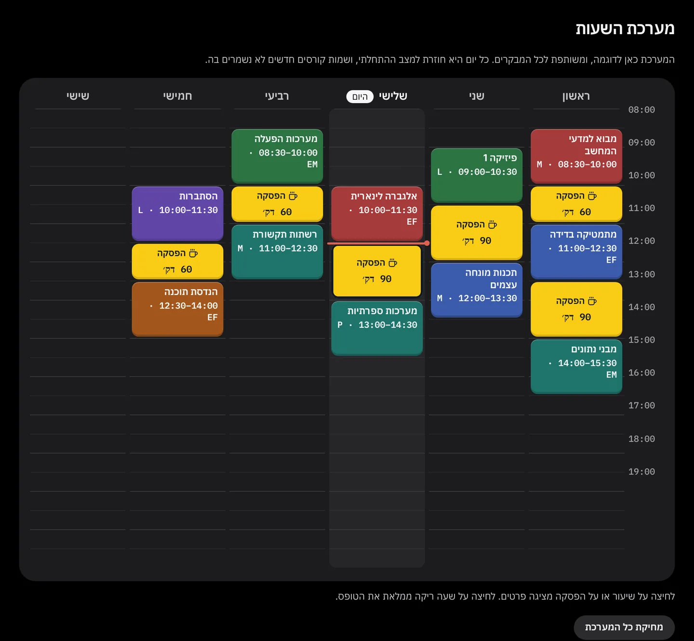 |

**On a phone**

| Light | Dark |
|---|---|
| 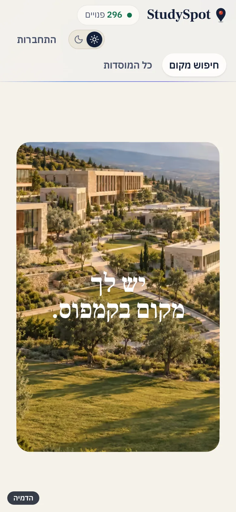 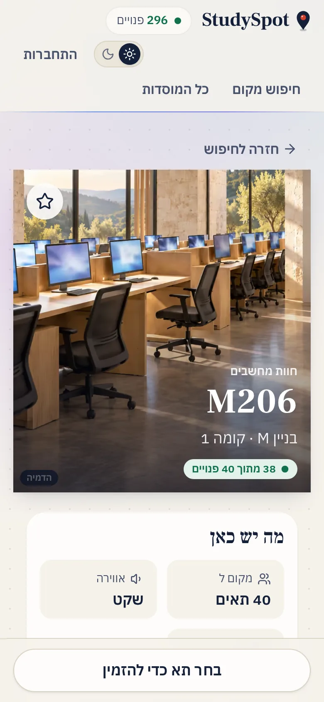 | 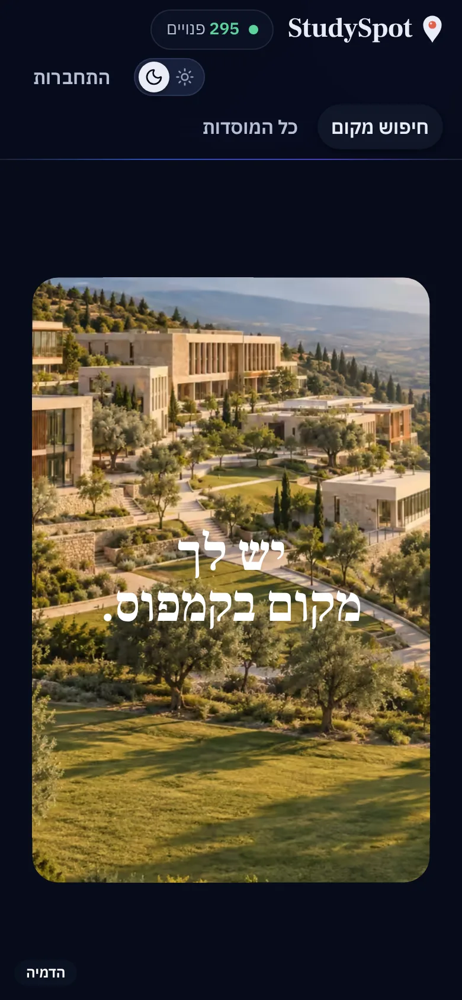 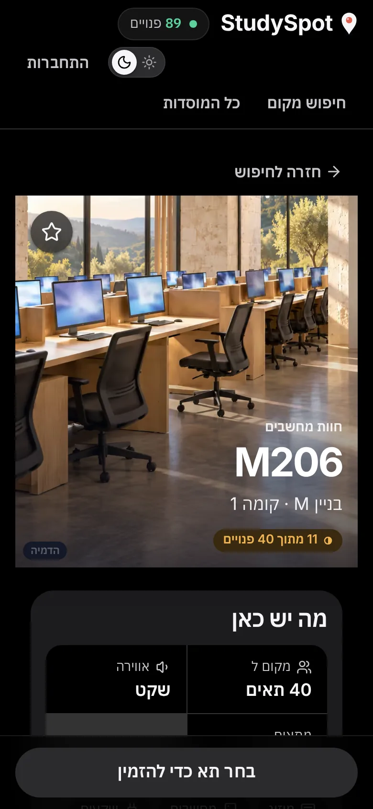 |

*Photos on the site are AI-generated illustrations, marked "הדמיה" (simulation). They are not photos of a real campus. Data on the demo campus is simulated.*

## Architecture

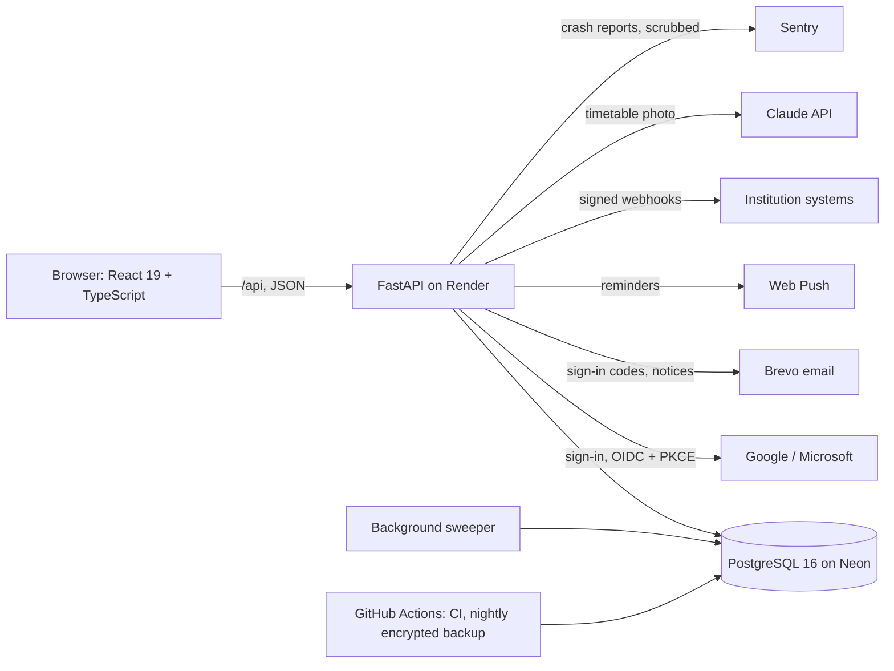

One container serves the web app and the API from the same address, so the sign-in cookie is first-party. The sweeper releases no-shows, ends expired check-ins, sends reminders and records occupancy history. It runs while the site has visitors, or when a reminder is due, so the database can sleep.

The core of the database, eight of its 30 tables. The rest are supporting tables (sign-in, opening hours, notices, API keys, webhooks). [Database notes](docs/design/database.md) explain the keys and the rules the database enforces.

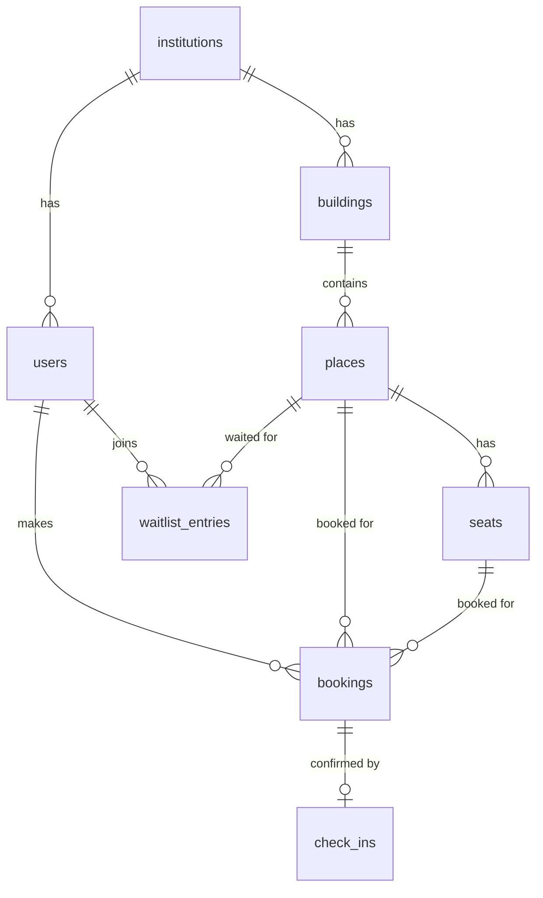

## Security, in short

- Sign-in with Google or Microsoft (OIDC with PKCE), an email code, or a password (`argon2id`), with lockout after five tries.
- A 15-minute access token in memory and a refresh cookie (`HttpOnly`, `Secure`, `SameSite`), rotated on use.
- Every API route has a row in an access table. Tests then check the refusals: a guest, a student, an institution admin, another student's things, and another institution's things.
- A strict Content Security Policy, rate limits, a request body cap, and an SSRF guard for webhooks.
- Crash reports go to Sentry with no emails, codes, cookies, request bodies or addresses. A test runs a real crash through the library and checks what would have been sent.
- `CodeQL`, `pip-audit`, `npm audit` and `gitleaks` on every push, and Dependabot every week.

## Known limitations

- Occupancy is only as good as the scanning. Auto check-out, "are you still here?" and no-show release reduce the error, but they do not remove it.
- Nothing can see a chair. Someone who stays after their time is only a guess ("maybe still taken"), and a break is kept by trust until the sign is scanned again. The report and the institution's table are the answer, not a guarantee.
- A photo of a printed QR sign could be scanned from home. The door screen, with a code that changes every minute, closes this. Otherwise the admin sees a warning on a sign with far more check-ins than seats and can replace its code, and one active check-in per person limits the damage.
- The demo campus's history and live crowd are simulated, and marked so on screen.
- The free hosting sleeps when idle, and the first visit is slow.
- A load test on a local server showed it handles about 80 requests a second; above that it answers "busy" quickly instead of stalling. The live free server is weaker and was not tested.

## More

- [Design notes](docs/design/README.md): requirements, the database, the pages, how I worked with AI, architecture, how double booking is prevented, decisions and trade-offs, and testing.
- [API for institutions](docs/API.md), and on the live site the `/developers` page and `/api/v1/openapi.json`.
- [Browser and device results](docs/browserstack/RESULTS.md).

## Running locally

```bash
cp .env.example .env              # then replace every change-me with one real password
docker compose up -d              # PostgreSQL 16
cd backend
python -m venv .venv && source .venv/bin/activate   # Windows: .venv\Scripts\activate
pip install --require-hashes -r requirements-dev.lock   # the exact locked versions
pip install --no-deps -e .
alembic upgrade head              # create the tables
python -m app.seed                # load Braude, and the demo campus the live site shows
python -m app.codes braude        # print the signed check-in code of every place
python -m app.admin grant-role --email you@example.edu institution_admin
pytest                            # uses a separate studyspot_test database
uvicorn app.main:app --reload     # http://localhost:8000/health, docs at /docs
```

The web app, in a second terminal ([frontend/README.md](frontend/README.md)):

```bash
cd frontend
cp .env.example .env.local
npm install
npm run dev                       # http://localhost:5173
```

To sign in without a Google or Microsoft account, set `DEMO_LOGIN_ENABLED=true` in `.env`. The sign-in page then offers a demo student and a demo institution admin, in the demo campus. The server refuses demo sign-in for an institution with real sign-in rules, so it can never hand out a real institution's admin.

## The whole site in one container

```bash
docker build -t studyspot .
docker run -p 8000:8000 --env-file .env -e SITE_URL=http://localhost:8000 studyspot
```

Every push runs [CI](.github/workflows/ci.yml): the server's tests on a real PostgreSQL, the web app's lint, types, unit tests and build within a size cap, the whole site in a browser on three devices, and the image.

## Rights

All rights reserved for now. The code is public so it can be read and discussed.
