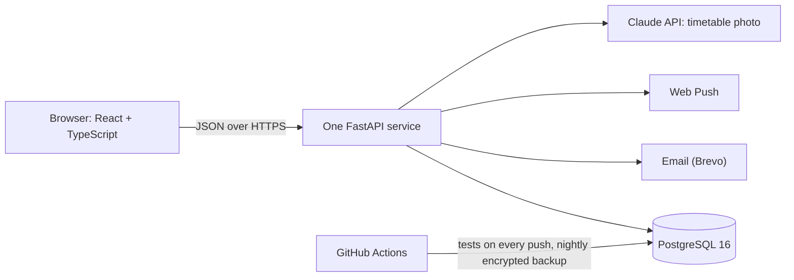

# Architecture

## The pieces

| Part | What it is | Why |
|---|---|---|
| Web app | React 19, TypeScript, Vite, Leaflet for the map | One codebase for every device, no app store |
| Service | One FastAPI process: it serves the built web app and the API under `/api` | One address for site and API, so the sign-in cookie belongs to the site itself |
| Database | PostgreSQL 16 | Enforces the rules that must never break (see double booking) |
| Background task | Runs inside the service, every minute while there are visitors | Releases bookings nobody showed up for, ends old check-ins, sends reminders, stores history |
| CI | GitHub Actions | Tests, linting and security scans on every push; encrypted nightly backup |

## Layers inside the service
| Layer | Job | Example |
|---|---|---|
| Route | Read the request, check permission, call an action | `backend/app/api/bookings.py` |
| Action | The business rules | `create_booking` in `backend/app/bookings.py` |
| Model | The data and its constraints | `Booking` in `backend/app/models/bookings.py` |

Actions can be tested without a server, and routes can change without touching the rules.

## Multi-tenancy
Every building, place and user belongs to an institution. Composite foreign keys include the institution, so the database itself refuses to mix data from two institutions. A new institution gets its own admin, uploads its campus as a table, and places its buildings on the map. It needs no code change.

## Sign-in and sessions
- OpenID Connect with PKCE (Google and Microsoft), plus email codes and passwords.
- A user joins an institution by the organisation ID of the identity provider, not by email address. Microsoft does not verify the email claim, so matching by email would allow the known "nOAuth" attack.
- Short-lived access token (15 minutes), kept in memory only. A rotating refresh token lives in an HttpOnly cookie. Presenting an old refresh token again revokes the whole session.

## Abuse protection
- Every route is listed in one access table (who may call it), and a test checks that no route is missing.
- Per-address rate limits. The email-code endpoint also asks the browser to solve a small proof-of-work puzzle first, and the strict limits are counted only after the puzzle is verified. This makes flooding more expensive; it does not prove the visitor is human.
- Content-Security-Policy allows scripts only from the site itself.

## Behaviour under load
The database connection pool waits at most 5 seconds. If no connection is free, the service answers `503` with `Retry-After: 2` instead of hanging for 30 seconds, and the browser retries once.

## Deploy
`Dockerfile` builds the web app, then the service. On start, `deploy/start.sh` runs the migrations and starts the server. The service runs on Render with the database on Neon. See [`docs/DEPLOY.md`](../DEPLOY.md).
