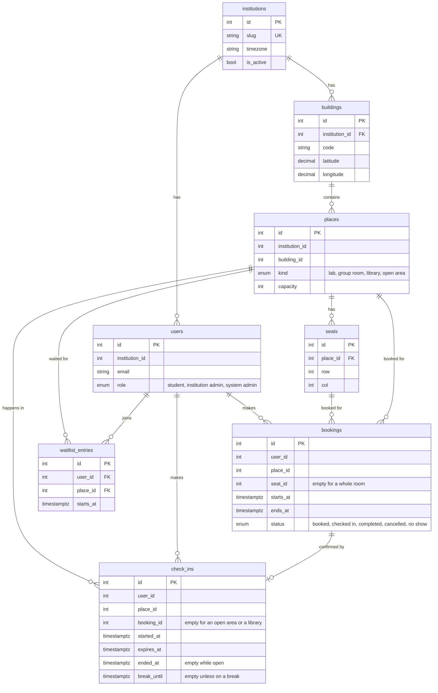

# Database

PostgreSQL 16, 31 tables. The models are in `backend/app/models/` and the schema changes are migrations in `backend/migrations/` (Alembic). A CI step (`alembic check`) fails if a model and the migrations disagree.

## The core tables

Eight of the 31 tables carry the main story: an institution has buildings, a building has places, a place can have seats, a student (user) books a place or a seat, and checking in (scanning a code) confirms it. The rest are supporting: sign-in, opening hours, notices, API keys, webhooks and so on.

`PK` is a primary key, `FK` a foreign key, `UK` a unique column. Columns that are part of a composite foreign key (for example `user_id` with `institution_id` in `bookings`) are not marked. The other 23 tables are in `backend/app/models/`.

`occupancy_reports` holds a student's report that their booked place was taken. It points at the reporter's own booking and never at the person who stayed, and it is deleted after 90 days (`backend/app/models/reports.py`).

## Terms, with an example from this project

| Term | What it is | Example here |
|---|---|---|
| Primary key | A column that identifies a row and never repeats | `bookings.id` |
| Foreign key | A column that points at a row in another table. The database refuses a pointer to a row that does not exist | `seats.place_id` points at `places.id` |
| Composite foreign key | A foreign key made of two columns together | `bookings` points at `users` by `user_id` and `institution_id` together |
| `CHECK` | A rule about one row | `ends_at > starts_at` on a booking |
| `UNIQUE` | No two rows may have the same values in these columns | no two seats with the same row and column in a place |
| Index | A structure that makes a lookup fast, like the index at the back of a book | `ix_bookings_user_status` |
| Partial index | An index over only some of the rows | one open check-in per user: only rows where `ended_at IS NULL` |
| `EXCLUDE` | No two rows may "collide" by a rule. Here: the same room, over overlapping time | `ex_bookings_room_overlap` |

## Rules the database enforces, not only the code

The rule that matters most is that two people cannot hold the same room at the same time. It is enforced in the database, because a check in application code can be beaten by two requests arriving together. Details, and the concurrency test: [Preventing double booking](preventing-double-booking.md).

| Rule | How | Where |
|---|---|---|
| No overlapping booking of a room, or of a seat | `EXCLUDE` constraints over the time range, for active bookings | `backend/app/models/bookings.py` |
| A booking must end after it starts | `CHECK` | `backend/app/models/bookings.py` |
| One open check-in per person, and per seat | partial unique indexes over open rows | `backend/app/models/checkins.py` |
| A check-in confirms at most one booking | `UNIQUE (booking_id)` | `backend/app/models/checkins.py` |
| Data of two institutions cannot be mixed | composite foreign keys that include `institution_id` | `fk_bookings_user`, `fk_bookings_place` in `backend/app/models/bookings.py` |
| A seat belongs to the place it is booked in | composite foreign key `(seat_id, place_id)` | `fk_bookings_seat` |

The composite keys mean the database refuses to save a booking, a check-in or a place whose user, place or building belongs to a different institution. Reading is still filtered by the application, and some tables, such as `waitlist_entries`, have plain foreign keys without this protection.
