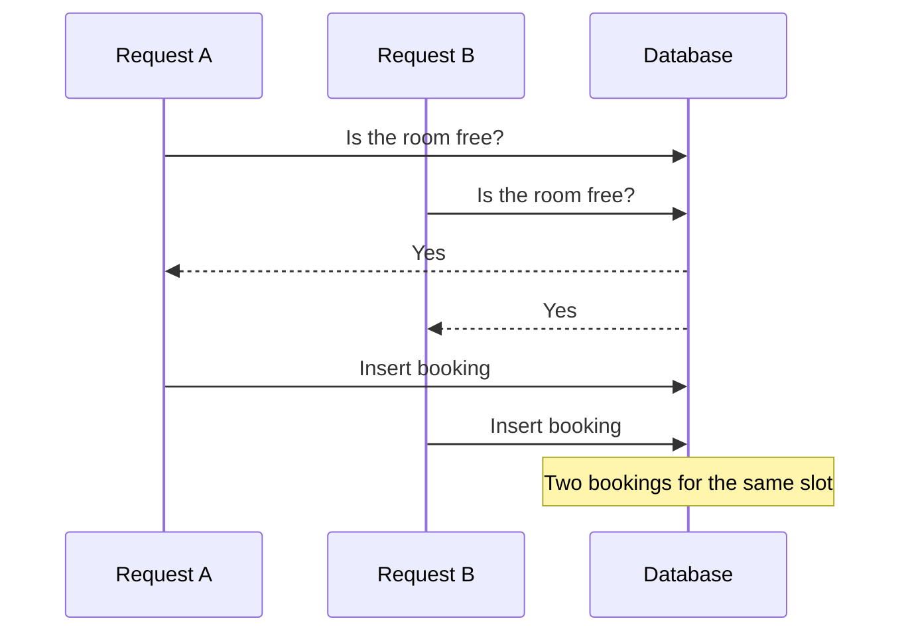
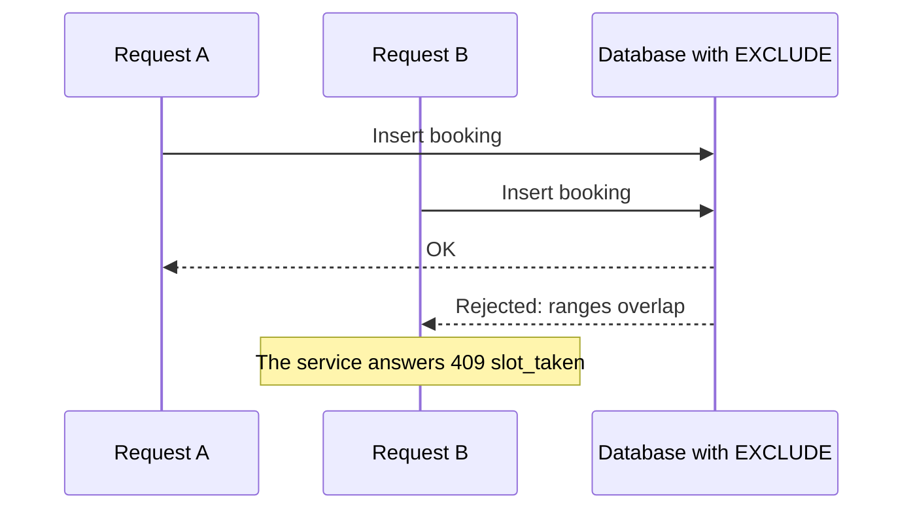

# Preventing double booking

## The problem
Two students press "Book" on the same room, for the same hour, in the same second.

The naive fix is to check in code, "is the room free?", and then insert the booking. It fails because both requests check at the same moment, both see "free", and both insert. This kind of bug is called a race condition: it depends on timing, so it rarely shows up in ordinary tests.



## The solution: the database refuses
An exclusion constraint on the `bookings` table says that two active bookings of the same room may not have overlapping time ranges.

```sql
-- shape of the rule (see backend/app/models/bookings.py)
EXCLUDE USING gist (
  place_id WITH =,
  tstzrange(starts_at, ends_at, '[)') WITH &&
) WHERE (seat_id IS NULL AND status IN ('booked', 'checked_in'))
```

- Same room: `place_id WITH =`.
- Time ranges that overlap: `tstzrange(...) WITH &&`.
- `'[)'` includes the start and excludes the end, so a booking until 14:00 and one from 14:00 do not clash.
- A cancelled booking does not block anyone (the `WHERE` clause).
- A second constraint applies the same rule to single seats in a computer lab.
- It needs the `btree_gist` extension, created in a migration.



The service inserts inside a savepoint. When PostgreSQL rejects the row with an exclusion violation, the service turns it into a `409 slot_taken` and the user sees "Someone just booked this time. Pick another."

## Why the database and not a lock in code
The database is the one place no code path can bypass. Future code that forgets to check, or an admin tool, still cannot create a double booking. The cost: the error has to be translated, and the extension is required.

## Three other places with the same problem
| Situation | Solution |
|---|---|
| Ten students scan the last free spot in an open area | Lock the place row (`SELECT ... FOR UPDATE`) before counting |
| A student sends two bookings at once and passes the limit of two | Lock the student row before counting their bookings |
| Two active check-ins for one student or one seat | Partial unique indexes |

## The tests
- Ten threads, each with its own database connection, are released together by a barrier. Exactly one booking succeeds and nine get `slot_taken`. It runs for a room and for a seat.
- Ten students scan a place with capacity one: exactly one gets in and nine get `place_full`.
- In a local load test, 20 and 50 different students booking the same room at once produced exactly one `201` and all the others `409`.

Each thread needs its own connection because a race exists only between separate transactions. In a normal test everything runs in one transaction, so there would be no race at all.

## What the tests prove, and what they do not
They prove that with ten real concurrent requests on a real PostgreSQL, one booking gets in. They do not prove it holds for every possible timing. A concurrency test shows that the bug did not appear, not that it cannot. That is why the rule lives in the database and not in a test.
