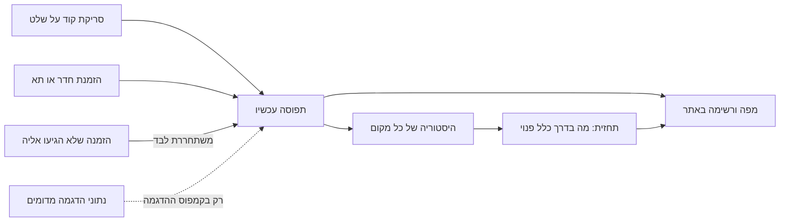

# 1. המוצר: מה בנית, ולמי

## במשפט אחד
- **האתר `StudySpot` מראה אילו מקומות לימוד בקמפוס פנויים עכשיו, מה צפוי להיות פנוי אחר כך, ואיפה לשבת בין שיעורים.** **[מתועד]** `README.md`

## הבעיה
- **סטודנטים מבזבזים זמן בחיפוש אחרי מקום פנוי.** אין מידע בזמן אמת על תפוסה, ובבראודה אפשר רק להזמין חדר קבוצתי מראש. **[מתועד]** `docs/PLAN.md`, פרק "רקע"; `docs/COMPETITIVE_ANALYSIS.md`
- **מה גרם לבחור בבעיה הזו:** **[נמסר]** החוויה שלך כסטודנט בבראודה. לנסח במילים שלך.

## המשתמשים
| תפקיד | מה הוא עושה | הראיה |
|---|---|---|
| אורח | רואה תפוסה, מקומות וחיזוי, בלי להתחבר | **[מתועד]** טבלת `ACCESS` ב-`backend/tests/test_access_matrix.py`, השורות `public` |
| סטודנט | מזמין, נכנס בקוד, יוצא, רשימת המתנה, מערכת שעות, יומן, התראות | **[מתועד]** `frontend/src/me/MyPage.tsx`, `backend/app/bookings.py` |
| מנהל מוסד | מקים את הקמפוס: כללי כניסה, בניינים, מקומות, שלטים, מסכים, וחיבורים | **[מתועד]** `frontend/src/admin/AdminPage.tsx` |
| מנהל מערכת | יוצר מוסדות, שולח הזמנה למנהל, מאשר כללי כניסה, וסוגר מוסד | **[מתועד]** `frontend/src/system/SystemPage.tsx` |

- **מי יכול להיות מנהל מערכת:** רק כתובת מייל שרשומה בהגדרות השרת, `SYSTEM_ADMIN_EMAILS`. **[מתועד]** `backend/app/auth.py`, `demote_unlisted`

## ההיקף
- **ארבעה סוגי מקומות:** חדר קבוצתי, מתחם פתוח, ספרייה, וחוות מחשבים עם מפת תאים. **[מתועד]** `docs/PLAN.md`; `ck_places_place_kind` ב-`backend/app/models/campus.py`
- **כמה מוסדות באתר אחד:** לכל מוסד כתובת משלו, למשל `/demo`. **[מתועד]** `frontend/src/router.tsx`, הנתיב `:slug`
- **באוויר:** `https://getstudyspot.me`, עם קמפוס הדגמה פתוח. **[מתועד]** `docs/DEPLOY.md`

## הייחוד
1. **"בין שיעורים":** לפי מערכת השעות, הצעה לכל הפסקה. **[מתועד]** `docs/COMPETITIVE_ANALYSIS.md`. **[מוסק]** שאין מוצר אחר שעושה את זה: לפי בדיקה של דפים ציבוריים בלבד.
2. **בלי חומרה:** שלט `QR` מודפס, או מסך עם קוד שמתחלף כל דקה. **[מתועד]** `frontend/src/screen/ScreenPage.tsx`
3. **מוסד מקים את עצמו, בלי קוד.** **[מתועד]** `frontend/src/admin/Setup.tsx`

## המגבלות
| מגבלה | למה | הראיה |
|---|---|---|
| התפוסה טובה רק כמו הסריקות | אין חיישנים | **[מתועד]** `README.md`, "Known limitations" |
| קמפוס ההדגמה מדומה | אין משתמשים אמיתיים | **[מתועד]** הדגל `simulated` בטבלאות `check_ins`, `users` ו-`occupancy_history` |
| השרת החינמי נרדם | שרת חינמי ב-`Render` | **[מתועד]** `render.yaml`, `plan: free` |
| אין עדיין מוסד אמיתי שמשתמש בו | בראודה לא אישרה כניסה עם מיקרוסופט | **[מתועד]** `docs/BRAUDE_LAUNCH.md` |

## מתחרים
- **הפירוט:** `docs/COMPETITIVE_ANALYSIS.md`, ובדוח הראיון, "מתחרים, ובמה אנחנו שונים".
- **הקרוב ביותר:** `Affluences`, שמשלב תפוסה מחיישנים עם הזמנה. **[מתועד]** לפי תוצאות חיפוש, 25.10.2026.

## מה השתנה מאז 25.10 (עדכון 1.11)
- **מה נוסף:** חידת עבודה לפני קוד כניסה למייל, סימון שלט שהקוד שלו אולי משותף, התנהגות מסודרת בעומס יתר (`503`), דיווח תקלות ב-`Sentry`, בדיקה על מכשירים אמיתיים ב-`BrowserStack`, בדיקות מקלדת ונגישות, ושיפור הנראות בגוגל. **[מתועד]** פרקי גל 16 ב-`docs/INTERVIEW_REPORT.md`.
- **מאיפה הנתונים (שאלה שחוזרת, גם בלינקדאין):** אין חיישנים ואין דיווח חופשי. ה-`data source` הוא פעולות באתר: כניסה בסריקת קוד על שלט, והזמנה. הזמנה שלא הגיעו אליה משתחררת לבד, והיסטוריה של כל מקום מזינה את התחזית. **[מתועד]** `backend/app/checkins.py`, `backend/app/bookings.py`, `backend/app/forecast.py`.
- **הבחנה חשובה:** המנגנון אמיתי, אבל התפוסה בקמפוס ההדגמה מדומה (משתמשים שנוצרו בסקריפט, מסומנים `simulated`, מתאפסים יום-יום), כי עוד אין סטודנטים אמיתיים. **[מתועד]** `backend/app/campus_admin.py`, `reset_demo_if_due`.

## מאיפה הנתונים: תרשים

