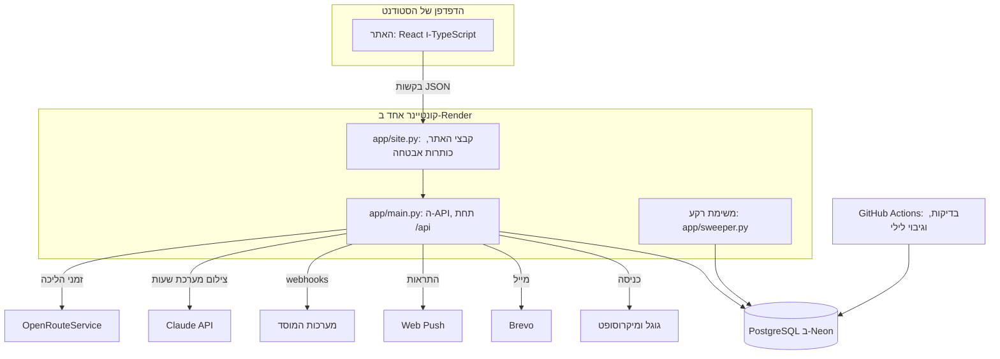

# 4. מבנה המערכת

## התרשים

## כל רכיב, במילים פשוטות
| רכיב | מה הוא | למה צריך אותו | הראיה |
|---|---|---|---|
| האתר | קבצי `JavaScript` שרצים בדפדפן. בונים אותם פעם אחת, ב-`npm run build` | מה שהמשתמש רואה ולוחץ | **[מתועד]** `frontend/src/main.tsx`, `Dockerfile` |
| `app/site.py` | השרת החיצוני: מגיש את קבצי האתר, ומוסיף כותרות אבטחה, כמו `CSP` | כתובת אחת לאתר ולשרת, ולכן העוגייה של הכניסה היא "של האתר עצמו" | **[מתועד]** `backend/app/site.py` |
| `app/main.py` | ה-`API`: כל הנתיבים, תחת `/api` | הלוגיקה, ההרשאות והמסד | **[מתועד]** `backend/app/main.py` |
| המסד | מסד `PostgreSQL 16`, ב-`Neon` | שומר הכול, ואוכף את הכללים | **[מתועד]** `render.yaml` |
| משימת הרקע | רצה בתוך השרת, כל דקה, כשיש מבקרים או תזכורת קרובה | משחררת מי שלא הגיע, סוגרת כניסות, שולחת תזכורות ושומרת היסטוריה | **[מתועד]** `run_forever` ב-`backend/app/sweeper.py` |
| `GitHub Actions` | בדיקות בכל דחיפה, וגיבוי מוצפן כל לילה | לתפוס שבירה לפני שהיא מגיעה לאתר | **[מתועד]** `.github/workflows/ci.yml`, `.github/workflows/backup.yml` |

### מושגים
- **ממשק, `API`:** אוסף כתובות בשרת שהאתר קורא אליהן, ומקבל תשובה ב-`JSON`. למשל `POST /api/bookings` יוצר הזמנה.
- **שכבת ביניים, `middleware`:** שכבה שכל בקשה עוברת דרכה לפני הנתיב. אצלנו, בין השאר, מבחוץ פנימה: דחיסה, `CORS`, ומגבלת גודל. מגבלת הגודל בפנים, כדי שגם תשובת 413 תקבל כותרות `CORS`. **[מתועד]** `backend/app/main.py`, `backend/app/site.py`
- **מיפוי למסד, `ORM`:** ספרייה שהופכת שורות במסד לאובייקטים של `Python`. אצלנו `SQLAlchemy`. **[מתועד]** `backend/app/db.py`
- **מיגרציה:** קובץ שמשנה את מבנה המסד צעד אחר צעד, ונשמר בגיט. אצלנו `Alembic`, ב-`backend/migrations/`. **[מתועד]**

## השכבות בתוך השרת
| שכבה | מה היא עושה | דוגמה |
|---|---|---|
| נתיב | קורא את הבקשה, בודק הרשאה, וקורא לפעולה | הפונקציה `create`, ב-`backend/app/api/bookings.py` |
| פעולה | הכללים העסקיים | הפונקציה `create_booking`, ב-`backend/app/bookings.py` |
| מודל | איך הנתונים נראים במסד, כולל האילוצים | המחלקה `Booking`, ב-`backend/app/models/bookings.py` |

- **למה כך:** את הפעולה אפשר לבדוק בטסט בלי שרת, ואת הנתיב אפשר להחליף בלי לגעת בכללים. **[מוסק]**

## עלייה לאוויר
1. **דחיפה לענף:** `Render` בונה את ה-`Dockerfile`: קודם האתר ב-`Node`, אחר כך השרת ב-`Python`. **[מתועד]** `Dockerfile`
2. **בהפעלה:** `deploy/start.sh` מריץ את המיגרציות, טוען את נתוני הקמפוס, ומפעיל את `uvicorn`. **[מתועד]**
3. **בריאות:** `Render` בודק את `/api/health` כל 30 שניות. **[מתועד]** `HEALTHCHECK` ב-`Dockerfile`
4. **הדומיין:** `getstudyspot.me`, מ-`Namecheap`, מכוון ל-`Render`. **[מתועד]** `docs/DEPLOY.md`

## השירותים החיצוניים
- **הרשימה המלאה, ומה פג ומתי:** `docs/SERVICES.md`. **[מתועד]**
- **מה קורה כששירות נופל:**
  - **זמני הליכה:** חוזרים להערכה בקו ישר. **[מתועד]** `docs/ROADMAP.md`, 9.2
  - **התראה בטלפון שלא הגיעה:** נשלח מייל, אם יש כתובת מאומתת. **[מתועד]** `docs/ROADMAP.md`, 11.3
  - **צילום מערכת שעות בלי מפתח `Anthropic`:** האפשרות לא מוצגת. **[מתועד]** `get_photo_reader` ב-`backend/app/api/classes.py`
