# 5. מסד הנתונים

- **29 טבלאות, ב-`PostgreSQL 16`.** **[מתועד]** נספרו מ-`Base.metadata` ב-25.10.2026.
- **המקור:** המודלים ב-`backend/app/models/`, והמיגרציות ב-`backend/migrations/`.
- **התרשים נוצר אוטומטית מהמודלים, ולא נכתב ביד.** כל טבלה בקוד מופיעה בו, ולהפך.

## מושגים
| מושג | מה זה | דוגמה מהפרויקט |
|---|---|---|
| טבלה | רשימה של שורות באותו מבנה | הטבלה `bookings`: כל שורה היא הזמנה |
| מפתח ראשי | עמודה שמזהה שורה, ולא חוזרת | `bookings.id` |
| מפתח זר | עמודה שמצביעה על שורה בטבלה אחרת. המסד לא מרשה להצביע על שורה שלא קיימת | העמודה `bookings.user_id` מצביעה על `users.id` |
| מפתח זר מורכב | מפתח זר של שתי עמודות יחד | הטבלה `bookings` מצביעה על `users` לפי `user_id` ו-`institution_id` יחד |
| `CHECK` | כלל על שורה אחת | `ends_at > starts_at` |
| `UNIQUE` | אסור ששתי שורות יהיו זהות בעמודות האלה | אין שני בניינים עם אותו קוד באותו מוסד |
| אינדקס | מבנה שמאיץ חיפוש, כמו אינדקס בסוף ספר | `ix_bookings_user_status` |
| אינדקס חלקי | אינדקס רק על חלק מהשורות | כניסה פתוחה אחת למשתמש: רק שורות עם `ended_at IS NULL` |
| `EXCLUDE` | אסור ששתי שורות "יתנגשו" לפי כלל. אצלנו: אותו חדר, וזמנים חופפים | `ex_bookings_room_overlap` |

## למה מפתח זר מורכב, בשורה אחת
- **כדי שהמסד עצמו ימנע ערבוב בין מוסדות.** הזמנה של סטודנט מבראודה למקום של מוסד אחר פשוט לא תיכנס, גם אם בקוד יש באג. **[מתועד]** `fk_bookings_user` ו-`fk_bookings_place` ב-`backend/app/models/bookings.py`

## הטבלאות, לפי נושא
| נושא | הטבלאות | הקובץ |
|---|---|---|
| הקמפוס | `institutions`, `buildings`, `places`, `seats`, `place_amenities`, `walk_times` | `backend/app/models/campus.py` |
| שעות | `opening_hours`, `special_periods`, `special_period_places` | `backend/app/models/hours.py` |
| אנשים וכניסה למערכת | `users`, `user_identities`, `sessions`, `email_sign_in_codes`, `institution_login_rules`, `admin_invites` | `backend/app/models/people.py` |
| שימוש במקומות | `bookings`, `check_ins`, `waitlist_entries`, `occupancy_history` | `backend/app/models/bookings.py`, `backend/app/models/checkins.py`, `backend/app/models/waitlist.py`, `backend/app/models/history.py` |
| הסטודנט | `class_slots`, `calendar_feeds`, `push_subscriptions`, `notice_emails`, `closing_notices` | `backend/app/models/classes.py`, `backend/app/models/calendar.py`, `backend/app/models/push.py` |
| מסכים | `place_screens` | `backend/app/models/screens.py` |
| חיבורים למוסד | `api_keys`, `webhook_endpoints`, `webhook_deliveries`, `webhook_test_hits` | `backend/app/models/api_keys.py`, `backend/app/models/webhooks.py` |

## האילוצים החשובים לראיון
| אילוץ | הטבלה | מה הוא מבטיח |
|---|---|---|
| `ex_bookings_room_overlap` | `bookings` | אין שתי הזמנות פעילות לאותו חדר בזמנים חופפים |
| `ex_bookings_seat_overlap` | `bookings` | אין שתי הזמנות פעילות לאותו תא בזמנים חופפים |
| `uq_check_ins_one_active_per_user` | `check_ins` | לכל סטודנט כניסה פתוחה אחת לכל היותר |
| `uq_check_ins_one_active_per_seat` | `check_ins` | בכל תא יושב אדם אחד לכל היותר |
| `uq_check_ins_booking_id` | `check_ins` | הזמנה מאושרת פעם אחת |
| `uq_institution_login_rules_approved_value` | `institution_login_rules` | סיומת מייל מאושרת שייכת למוסד אחד בלבד |
| `ck_places_lab_layout` | `places` | לחוות מחשבים יש שורות ועמודות, ולשאר אין |
| `uq_sessions_token_hash` | `sessions` | כל חיבור שמור כ-`hash`, ולא כאסימון עצמו |

- **סודות לא נשמרים כמו שהם:** אסימונים של חיבור, יומן, מסך והזמנה, ומפתחות `API`, נשמרים רק כ-`hash` או `HMAC`. מי שגונב את המסד לא יכול להשתמש בהם. **[מתועד]** העמודות `token_hash` ו-`key_hash`
- **הדגל `simulated`:** מסמן נתונים מדומים של קמפוס ההדגמה, ב-`users`, `check_ins` ו-`occupancy_history`. **[מתועד]**

## התרשים
- **איך לקרוא:** `||--o{` פירושו "אחד לרבים". `||--o|` פירושו "אחד לאחד, או לאף אחד". הטקסט על הקו הוא עמודות המפתח הזר.
- **הטבלה `email_sign_in_codes`** עומדת לבד: קוד נשלח לכתובת מייל, עוד לפני שיש משתמש.

```mermaid
erDiagram
    bookings ||--o| check_ins : "booking_id"
    buildings ||--o{ class_slots : "building_id"
    buildings ||--o{ places : "building_id+institution_id"
    buildings ||--o{ walk_times : "from_building_id"
    buildings ||--o{ walk_times : "to_building_id"
    institutions ||--o{ admin_invites : "institution_id"
    institutions ||--o{ api_keys : "institution_id"
    institutions ||--o{ buildings : "institution_id"
    institutions ||--o{ institution_login_rules : "institution_id"
    institutions ||--o{ special_periods : "institution_id"
    institutions ||--o{ users : "institution_id"
    institutions ||--o{ webhook_endpoints : "institution_id"
    places ||--o{ bookings : "place_id+institution_id"
    places ||--o{ check_ins : "place_id+institution_id"
    places ||--o{ occupancy_history : "place_id"
    places ||--o{ opening_hours : "place_id"
    places ||--o{ place_amenities : "place_id"
    places ||--o{ seats : "place_id"
    places ||--o{ special_period_places : "place_id+institution_id"
    places ||--o{ waitlist_entries : "place_id"
    places ||--o| place_screens : "place_id"
    seats ||--o{ bookings : "seat_id+place_id"
    seats ||--o{ check_ins : "seat_id+place_id"
    special_periods ||--o{ special_period_places : "period_id+institution_id"
    users ||--o{ admin_invites : "created_by"
    users ||--o{ admin_invites : "used_by"
    users ||--o{ api_keys : "created_by"
    users ||--o{ bookings : "user_id+institution_id"
    users ||--o{ check_ins : "user_id+institution_id"
    users ||--o{ class_slots : "user_id"
    users ||--o{ notice_emails : "user_id"
    users ||--o{ push_subscriptions : "user_id"
    users ||--o{ sessions : "user_id"
    users ||--o{ user_identities : "user_id"
    users ||--o{ waitlist_entries : "user_id"
    users ||--o| calendar_feeds : "user_id"
    users ||--o| closing_notices : "user_id"
    webhook_endpoints ||--o{ webhook_deliveries : "endpoint_id"
    webhook_endpoints ||--o{ webhook_test_hits : "endpoint_id"
    email_sign_in_codes {
        int id
    }
```

