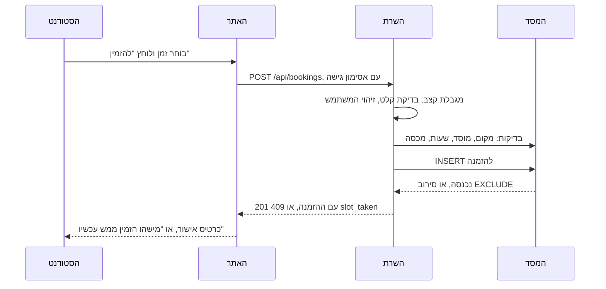

# 6. הזמנה מקצה לקצה: מה קורה כשלוחצים "להזמין"

- **כל צעד כאן נבדק מול הקוד ב-25.10.2026.** **[מתועד]** הקבצים והפונקציות כתובים ליד כל צעד.

## באתר
1. **הטופס:** הסטודנט בוחר משבצת ואורך. הפונקציה `book` בונה בקשה עם המקום, התא, ההתחלה והסוף. **[מתועד]** `frontend/src/features/booking/BookingForm.tsx`
2. **הקריאה לשרת:** `createBooking` שולחת `POST /bookings`, עם `auth: true`. **[מתועד]** `frontend/src/api/student.ts`
3. **האסימון:** `api` מוסיף כותרת `Authorization: Bearer`. אם האסימון פג, הוא מחליף אותו פעם אחת דרך `/auth/refresh`, ושולח שוב. **[מתועד]** `frontend/src/api/client.ts`

## בשרת, לפני הפעולה
4. **מגבלת קצב:** `write_limit` על הנתיב. **[מתועד]** `backend/app/api/bookings.py`, `backend/app/ratelimit.py`
5. **בדיקת קלט:** `BookingCreate` ב-`Pydantic` בודק את סוגי השדות. שגיאה מחזירה 422, בלי להחזיר את מה שנשלח. **[מתועד]** `backend/app/schemas.py`, `validation_failed` ב-`backend/app/main.py`
6. **מי המשתמש:** `get_current_user` מפענח את האסימון ושולף את המשתמש. בלי אסימון, 401. **[מתועד]** `backend/app/auth.py`

## בשרת, הפעולה עצמה
7. **עטיפה:** `run_action` מריץ את הפעולה בתוך `SAVEPOINT`. סירוב מבטל את כל מה שנכתב, והצלחה נשמרת ב-`commit`. **[מתועד]** `backend/app/api/actions.py`
8. **הפונקציה `create_booking`,** לפי הסדר: **[מתועד]** `backend/app/bookings.py`

| בדיקה | הסירוב |
|---|---|
| המקום קיים | 404 `place_not_found` |
| המקום במוסד של הסטודנט | 403 `other_institution` |
| המוסד לא בסגירה | `refuse_if_closing` |
| אפשר להזמין את סוג המקום הזה | 409 `not_bookable` |
| התא שייך למקום | `_check_seat` |
| הזמנים בתוך שעות הפתיחה, על רשת של 15 דקות, ועד שעתיים | `check_times` |
| לסטודנט פחות משתי הזמנות קדימה | 409 `too_many_bookings` |

9. **נעילה למכסה:** לפני ספירת ההזמנות, השורה של הסטודנט ננעלת ב-`with_for_update`. כך שתי בקשות שלו באותו רגע לא יעברו שתיהן את המכסה. **[מתועד]**
10. **שחרור ישן:** `release_no_shows` משחרר קודם הזמנה של מי שלא הגיע, באותו מקום. **[מתועד]**
11. **ההכנסה:** `insert_booking` מוסיף את השורה. אם המסד מסרב באילוץ `EXCLUDE`, הסירוב הופך ל-409 `slot_taken`. **[מתועד]**
12. **אחרי ההצלחה:**
    - הפונקציה `booking_event` רושמת `webhook` למוסד, `booking.created`. **[מתועד]** `backend/app/webhooks.py`
    - הפונקציה `ALARM.earliest` מקדימה את משימת הרקע, אם התזכורת קרובה. **[מתועד]** `backend/app/api/bookings.py`

## חזרה לאתר
13. **הצלחה, 201:** `onBooked` מציג את כרטיס האישור, וקורא מחדש את הזמנים. **[מתועד]** `BookingForm.tsx`
14. **הקוד `slot_taken`:** ההודעה "מישהו הזמין את הזמן הזה ממש עכשיו. בחר זמן אחר.", ובחדר קבוצתי הצעה להצטרף לרשימת המתנה. **[מתועד]** `frontend/src/i18n/errors.ts`
15. **הקוד `network_error`:** הזמנים נקראים מחדש, כי ייתכן שההזמנה הגיעה לפני שהקו נפל. **[מתועד]**

## מה קורה אחר כך
| מתי | מה | הקוד |
|---|---|---|
| 10 דקות לפני | תזכורת בטלפון, או במייל | `backend/app/reminders.py` |
| בהגעה | סריקה ב-`/scan`, וההזמנה הופכת ל-`checked_in` | `backend/app/checkins.py` |
| 15 דקות בלי סריקה | מצב `no_show`, והמקום משתחרר | הקבוע `NO_SHOW_AFTER`, ב-`backend/app/bookings.py` |
| בסוף | הכניסה נסגרת | `backend/app/sweeper.py` |

## שאלות שאפשר לקבל על המסמך הזה
- **"למה 404 ולא 403 למקום שלא קיים?"** כי זה באמת לא קיים. 403 הוא למקום שקיים, אבל במוסד אחר.
- **"למה `SAVEPOINT` ולא טרנזקציה רגילה?"** כדי שסירוב באמצע יבטל רק את הפעולה, והחיבור למסד יישאר תקין. **[מוסק]**
- **"מה אם שני סטודנטים לוחצים יחד?"** ראה `07-concurrency.md`.
