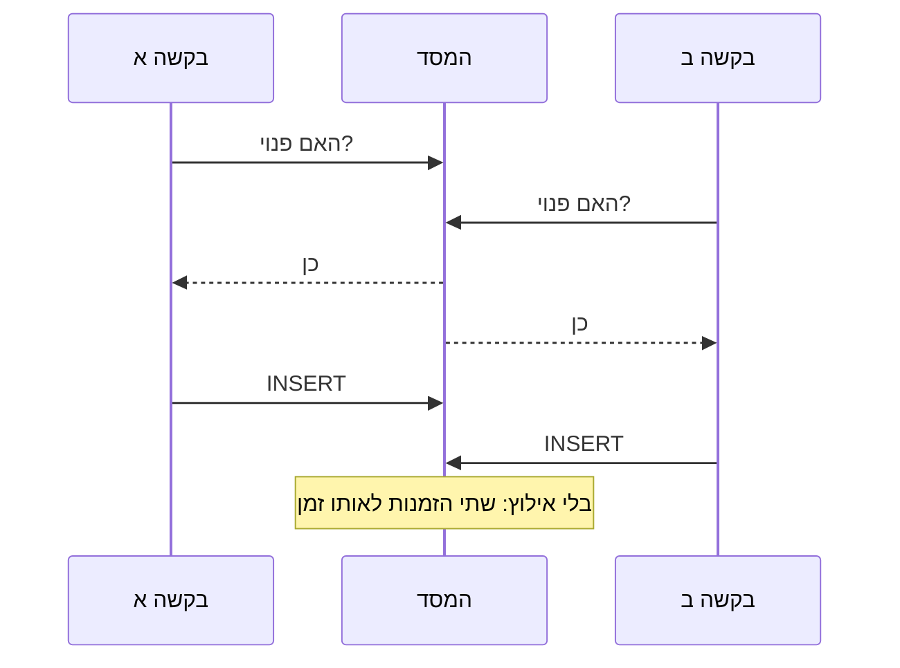

# 7. הזמנה כפולה ומקביליות

## הבעיה, בדוגמה
- **שני סטודנטים לוחצים "להזמין" על אותו חדר, לאותה שעה, באותה שנייה.**
- **הפתרון הנאיבי:** לבדוק בקוד "האם החדר פנוי?", ואם כן, להוסיף הזמנה.
- **למה זה לא עובד:** שתי הבקשות בודקות יחד, שתיהן רואות "פנוי", ושתיהן מוסיפות.

- **מושג, `race condition`:** באג שקורה רק כששתי פעולות רצות באותו זמן, ותלוי מי מגיע ראשון. קשה לתפוס אותו בבדיקה רגילה, כי ברוב הפעמים הוא לא קורה.

## הפתרון: המסד מסרב, ולא הקוד
- **אילוץ `EXCLUDE` בטבלת `bookings`:** אסור ששתי הזמנות פעילות יהיו לאותו חדר, בזמנים חופפים. **[מתועד]** `ex_bookings_room_overlap` ב-`backend/app/models/bookings.py`
- **איך הוא כתוב, בשפה פשוטה:**
  - אותו חדר: `place_id WITH =`;
  - טווחי זמן שחופפים: `tstzrange(starts_at, ends_at, '[)') WITH &&`;
  - רק הזמנות פעילות של חדר שלם: `WHERE seat_id IS NULL AND status IN ('booked', 'checked_in')`. הזמנה שבוטלה לא חוסמת.
- **הסימון `'[)'`:** ההתחלה כלולה, והסוף לא. לכן הזמנה עד 14:00 והזמנה מ-14:00 לא מתנגשות. **[מתועד]**
- **אילוץ שני לתאים:** `ex_bookings_seat_overlap`, אותו כלל לפי `seat_id`. **[מתועד]**
- **ההרחבה `btree_gist`:** מאפשרת לאינדקס אחד לשלב "שווה" עם "חופף". נוצרת במיגרציה. **[מתועד]** `backend/migrations/versions/2026_10_07_1138-03faa74dd953_add_bookings_with_exclusion_constraints.py`

## מה הקוד עושה עם הסירוב
- **הפונקציה `insert_booking`** מכניסה את השורה בתוך `SAVEPOINT`. אם המסד מסרב בקוד `EXCLUSION_VIOLATION`, הסירוב הופך ל-409 `slot_taken`. **[מתועד]** `backend/app/bookings.py`
- **באתר:** "מישהו הזמין את הזמן הזה ממש עכשיו. בחר זמן אחר." **[מתועד]** `frontend/src/i18n/errors.ts`

## שלושה מקומות נוספים עם אותה בעיה
| המצב | הפתרון | הראיה |
|---|---|---|
| עשרה סטודנטים סורקים את המקום האחרון במתחם פתוח | נעילת השורה של המקום, `with_for_update`, לפני הספירה | **[מתועד]** `_place_from_code` ב-`backend/app/checkins.py` |
| סטודנט שולח שתי הזמנות באותו רגע, ועובר את המכסה של שתיים | נעילת השורה של הסטודנט לפני ספירת ההזמנות | **[מתועד]** `create_booking` ב-`backend/app/bookings.py` |
| שתי כניסות פתוחות לאותו סטודנט, או לאותו תא | אינדקסים חלקיים ייחודיים | **[מתועד]** `uq_check_ins_one_active_per_user`, `uq_check_ins_one_active_per_seat` |

- **מושג, נעילת שורה:** `SELECT ... FOR UPDATE`. הבקשה השנייה מחכה עד שהראשונה מסיימת, ואז רואה את המצב החדש.
- **למה לא נעילה גם בהזמנה:** האילוץ מספיק, והוא לא מאט בקשות לחדרים אחרים. **[מתועד]** ההערה ב-`create_booking`: "Overlaps need no lock"

## הטסטים
| טסט | מה הוא עושה | מה הוא מצפה |
|---|---|---|
| `test_only_one_booking_wins` | עשרה `threads`, כל אחד בחיבור משלו למסד. `threading.Barrier` משחרר את כולם באותו רגע. רץ פעמיים: לחדר ולתא | בדיוק `ok` אחד, ותשעה `slot_taken` |
| `test_only_one_student_gets_the_last_spot` | עשרה סטודנטים סורקים מקום עם קיבולת 1 | בדיוק `ok` אחד, ותשעה `place_full` |

- **הקבצים:** `backend/tests/test_booking_concurrency.py` ו-`backend/tests/test_concurrency.py`. **[מתועד]**
- **למה חיבור נפרד לכל `thread`:** מרוץ קיים רק בין טרנזקציות שונות. בטסט רגיל הכול בטרנזקציה אחת, ולא היה מרוץ בכלל. **[מתועד]** ה-`docstring` בראש `test_concurrency.py`

## מה הטסט מוכיח, ומה לא
| מוכיח | לא מוכיח |
|---|---|
| שעם עשר בקשות אמיתיות במקביל, על `PostgreSQL` אמיתי, נכנסת אחת בלבד | שזה יחזיק בכל תזמון אפשרי. טסט מקביליות מראה שהבאג לא הופיע, לא שהוא לא יכול להופיע |
| שהסירוב מגיע כקוד הנכון, `slot_taken` | עומס גבוה: מאות בקשות בשנייה. לא נבדק |
| שאין נעילה בקוד ההזמנה, והאילוץ לבדו מחליט | התנהגות ברמת בידוד אחרת של המסד. **[מוסק]** האילוץ לא תלוי ברמת הבידוד |

- **מה עונים כשאומרים "טסט כזה לא מוכיח כלום":** ההוכחה היא האילוץ עצמו, שהמסד אוכף על כל `INSERT`. הטסט רק בודק שחיברנו אותו נכון, ושהקוד מתרגם את הסירוב. **[מוסק]**
