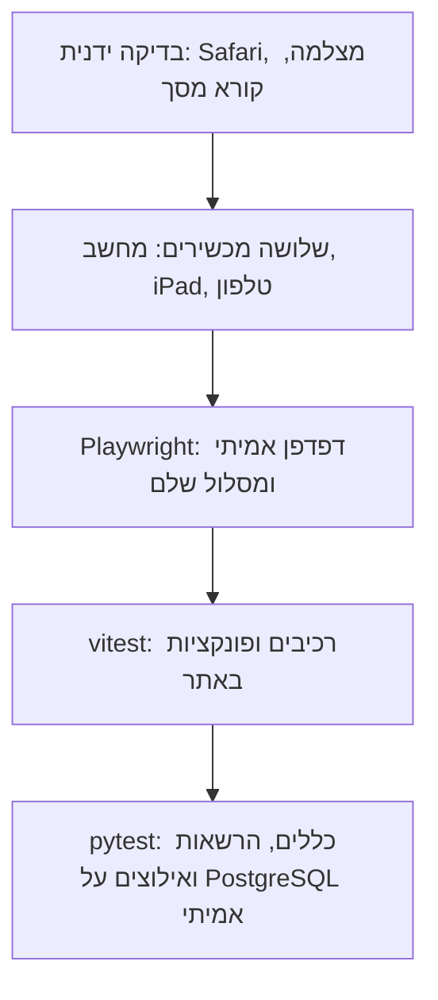

# 8. הבדיקות מול הדרישות: איך אתה יודע שזה עובד

## חמש שכבות של בדיקות
| שכבה | הכלי | כמה, ב-1.11 | מה היא תופסת |
|---|---|---|---|
| טסטים בשרת | בדיקות `pytest`, על `PostgreSQL` אמיתי | 1441 | כללים, הרשאות, אילוצים, מקביליות |
| טסטי יחידה באתר | `vitest` | 613 | רכיב אחד, או פונקציה אחת, בלי שרת |
| דפדפן אמיתי | `Playwright` | 51 | מסלול שלם: לחיצה, שרת, מסד |
| שלושה מכשירים | `Playwright`, `playwright.edge.config.ts` | 39 | מחשב, `iPad` וטלפון: גלישה מהמסך, גודל כפתורים, נגישות |
| בדיקה ידנית | אתה, בטלפון ובמחשב | | דפדפן `Safari` אמיתי, מצלמה, מייל, וטקסט לא ברור |

- **הכול רץ בגיטהאב על כל דחיפה,** חוץ מהבדיקה הידנית. **[מתועד]** `.github/workflows/ci.yml`
- **מושג, `TDD`:** כותבים טסט שנכשל, ורק אז את הקוד שגורם לו לעבור. בכל תיקון בסבב הבדיקות, הטסט נבדק גם על הקוד הישן, ונכשל שם. **[מתועד]** `docs/testing/FINDINGS.md`
- **מושג, בדיקת מוטציה:** שוברים את הקוד בכוונה, ובודקים שהטסט נכשל. כשהורסים את בדיקת ההרשאה, 27 מתוך 30 מקרים בטבלת ההרשאות נכשלים. **[מתועד]** דוח הראיון, "סבב בדיקות מלא"

## דרישה, מימוש, טסט
- **המספר בעמודה הראשונה** הוא מספר הדרישה ב-`02-requirements.md`.

| # | הדרישה | המימוש | הטסט | המצב |
|---|---|---|---|---|
| 1 | מבנה הקמפוס, עם כללים במסד | `backend/app/models/campus.py` | `backend/tests/test_constraints.py` | עובר |
| 2 | תפוסה, כניסה ויציאה | `backend/app/checkins.py` | `backend/tests/test_api_checkins.py`, `backend/tests/test_checkin_constraints.py` | עובר |
| 3 | אין הזמנה כפולה | `ex_bookings_room_overlap` | `backend/tests/test_booking_concurrency.py`, `backend/tests/test_booking_constraints.py` | עובר |
| 4 | כניסה והרשאות | `backend/app/api/auth.py` | `backend/tests/test_auth_flow.py`, `backend/tests/test_access_matrix.py` | עובר |
| 5 | כניסה פגה | `CHECK_IN_DURATION` | `backend/tests/test_sweeper.py` | עובר |
| 6 | שחרור מי שלא הגיע | `NO_SHOW_AFTER` | `backend/tests/test_booking_arrival.py` | עובר |
| 7 | האתר: מפה, רשימה, דף מקום, הזמנה | `frontend/src/` | `frontend/e2e/campus.spec.ts`, `frontend/e2e/actions.spec.ts` | עובר |
| 8 | קוד חתום | `backend/app/codes.py` | `backend/tests/test_codes.py` | עובר |
| 9 | התראות: טלפון ומייל | `backend/app/reminders.py` | `backend/tests/test_reminders.py`, `backend/tests/test_push.py`, `backend/tests/test_email_notices.py` | עובר. טלגרם לא נבנה |
| 10 | סיסמה | `backend/app/passwords.py` | `backend/tests/test_passwords.py`, `frontend/e2e/password.spec.ts` | עובר |
| 11 | עדכון חי | רענון כל 30 שניות | | **לא מומש** |
| 12 | חיזוי | `backend/app/forecast.py` | `backend/tests/test_forecast.py`, `frontend/e2e/forecast.spec.ts` | עובר |
| 14 | העלאת טבלת קמפוס | `backend/app/campus_import.py` | `backend/tests/test_campus_import.py` | עובר |
| 15 | רשימת המתנה | `backend/app/waitlist.py` | `backend/tests/test_waitlist.py`, `frontend/e2e/waitlist.spec.ts` | עובר. החלק על חידוש לא מומש |
| 16 | בין שיעורים | `backend/app/between_classes.py` | `backend/tests/test_between_classes.py`, `frontend/e2e/classes.spec.ts` | עובר |

- **"עובר" פירושו:** כל הטסטים בשורה עברו בריצה של 1.11. **[מתועד]** `pytest` עבר 1441, ו-`vitest` עבר 613 מתוך 613.

## הרשאות: טבלה אחת לכל הנתיבים
- **הרעיון:** לכל אחד מ-109 הנתיבים יש שורה שאומרת מי רשאי. שמונה סוגים, למשל `public` לכולם, `user` למחובר, `admin` למנהל המוסד, `api_key` למפתח של מוסד, ו-`system` למנהל המערכת. **[מתועד]** `ACCESS` ב-`backend/tests/test_access_matrix.py`
- **מה נבדק:** אורח מקבל 401, סטודנט מקבל 403 בנתיבי ניהול, ומנהל של מוסד אחר מקבל 403 או 404. **[מתועד]**
- **נתיב חדש בלי שורה בטבלה מכשיל את הטסט.** כך מי שמוסיף נתיב חייב להחליט מי רשאי. **[מתועד]**
- **מושג, `IDOR`:** גישה לנתון של מישהו אחר רק בהחלפת מספר בכתובת. זה מה שהטבלה תופסת.

## מה לא נבדק
| מה | למה | הראיה |
|---|---|---|
| דפדפן `Safari` אמיתי, ומצלמה אמיתית | הבדיקות רצות ב-`Chromium` | **[מתועד]** `A-9` ב-`docs/testing/TEST_PLAN.md`. **[נמסר]** בדקת בעצמך ב-`iPhone` |
| עומס | אין סביבה נפרדת | **[מתועד]** `P-3` |
| בדיקת `Lighthouse` באתר החי | מתוכנן ל-16.1 | **[מתועד]** `P-2` |
| מגבלת קצב לפי כתובת, מהסביבה שלנו | הסביבה יוצאת דרך כמה כתובות | **[מתועד]** `R-3` ב-`docs/testing/FINDINGS.md`. **[נמסר]** בדקת מהמחשב שלך: 429 אחרי 60 |

## עדכון 1.11: מה נוסף
- **בדיקות חדשות:** חידת העבודה (חתימה שגויה, פג תוקף, שימוש חוזר, קושי נמוך נדחים), סימון שלט חשוד, והתנהגות `503` בעומס. **[מתועד]** `backend/tests/test_pow.py`, `backend/tests/test_busy.py`.
- **בדיקת עומס מקומית:** כ-80 בקשות לשנייה בקיבולת, ומעליה כשל חד שתוקן ל-`503` מהיר. בקשות מקבילות על אותו חדר: אחת מצליחה, השאר נדחות. **לא נבדק האתר החי.** **[מתועד]** `docs/load/`.
- **מכשירים אמיתיים:** `BrowserStack`, כולל `iPhone` ו-`Safari`. **[מתועד]** `docs/browserstack/RESULTS.md`. **[נמסר]** את ה-`iPhone` בדקת בעצמך.
- **נגישות:** בדיקות ניווט במקלדת, התאמה לגודל מסך ולמצב ניגודיות. **[מתועד]** `frontend/e2e/a11y-keyboard.spec.ts`. קורא מסך אמיתי נשאר לבדיקה אנושית.

## איור: חמש שכבות הבדיקות

הכלל: ככל שיורדים, הבדיקות מהירות וזולות יותר ויש יותר מהן.
